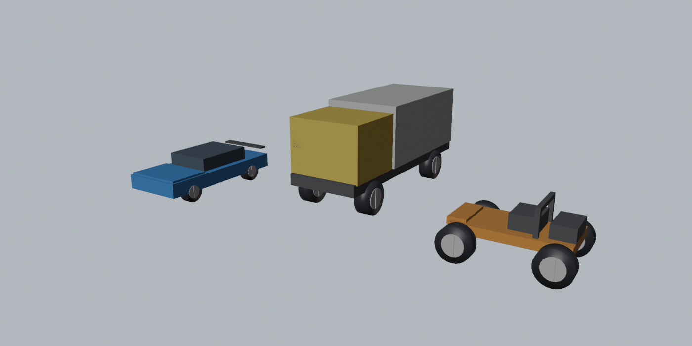

# Vehicle Physics

**Raycast-based car physics for Unity 6**: suspension that soaks up bumps and potholes, tire grip,
steering, handbrake drifts and a chase camera.

[English](#english) · [Türkçe](#türkçe)

<p align="center"></p>

---

<a name="english"></a>
# English

- Spring + damper suspension per wheel (separate bump/rebound damping, bump stops)
- Tire grip with a friction circle: the car slides when you ask too much of the tires
- Ackermann steering, speed-sensitive steering, anti-roll bars
- Rear-wheel, front-wheel or all-wheel drive
- Handbrake for drifting, reset button when you flip over
- Wheels visibly spin, steer and move up and down with the suspension
- Built-in test car and a procedural test track (bumps, speed bumps, potholes, ramp)
- Works with your own car model: a builder sets it up in one click
- Ready-made presets: **Default**, **Sports**, **Truck**, **OffRoad**
- Three sample models (sports car, truck, buggy) to practice with

**Requirements:** Unity 6 (6000.0+), Input System package.

## Step-by-step setup

### 1. Add the package

1. **Window > Package Manager** → **+** → **Install package from git URL…**
2. Paste and click **Install**:

   ```
   https://github.com/Atthree/VehiclePhysics.git
   ```

If Unity asks *"Enable the new input backends?"*, click **Yes**.

### 2. Try the test scene

1. **File > New Scene** (any template).
2. **Tools > Vehicle Physics > Create Test Scene (Track + Car)**.
3. Press **Play**.

| Keyboard | Gamepad | Action |
|---|---|---|
| W / ↑ | Right trigger | Accelerate |
| S / ↓ | Left trigger | Brake; reverse once stopped |
| A D / ← → | Left stick | Steer |
| Space | B | Handbrake (drift) |
| R | Y | Reset the car upright |
| Hold right mouse + move | – | Look around (camera returns behind the car) |

The test track runs along +Z from the start:

| Distance | Section |
|---|---|
| 0 – 30 m | Flat start (and loose crates on the left) |
| 30 – 80 m | Rolling bumps |
| 80 – 110 m | Speed bumps every 6 m |
| 110 – 150 m | Rough road with potholes |
| 150 – 200 m | Flat, then a ramp |

The panel in the top-left shows speed and each wheel's suspension compression.

### 3. Use your own car model

1. Put the car in the scene. Its front must face the blue arrow (+Z) and the wheels must touch the
   ground.
2. **Tools > Vehicle Physics > Builder (Your Own Model)**.
3. Drag the car root into **Araç Kökü** (Vehicle Root). Wheels named like `FL`, `Wheel_FR`,
   `wheel.rl`, `FrontLeftWheel`, `Wheel_Rear_Right` are found automatically; otherwise drag the four
   wheel meshes into the wheel fields.
4. Pick a preset under **Hazır Profil** (Default, Sports, Truck, OffRoad).
5. Click **Build**, then **Play**.

The builder:

- Adds a Rigidbody and a `VehicleController` to the root and applies the preset.
- Removes colliders from the wheel meshes (the suspension carries the wheels, not colliders).
- Adds a box collider around the body if the car has no collider, and makes non-convex mesh colliders
  convex (a moving Rigidbody can't use non-convex ones).
- If a wheel's pivot isn't at the wheel's center, it adds a centered `… Pivot` object above the
  wheel mesh, so the wheel spins around its own axle instead of wobbling.
- Creates a suspension point (`Wheel FL`, …) above each wheel. The height is calculated so that
  the wheels stay exactly where they are in the model when the car stands still.
- Reads the wheel radius from the wheel mesh.
- Warns you if the front wheels are not in the +Z direction (the model faces the wrong way).

**Practice models:** the package contains three models in **Packages > Vehicle Physics > Vehicles**,
each with a problem that real downloaded models often have:

<p align="center"></p>

| Model | Preset | What's special |
|---|---|---|
| `SportsCar` | Sports | Clean model: just drag in and Build |
| `Truck` | Truck | Wheel pivots are at the model origin, not the wheel centers: the builder fixes it |
| `Buggy` | OffRoad | Faces +X instead of +Z: fix it with the steps in [Using models from outside](#using-models-from-outside) |

## Using models from outside

Models from the Asset Store, Sketchfab, CGTrader, Kenney or your own Blender work fine if they meet
the checklist below. Check it **before** you click Build.

| # | Requirement | How to check | How to fix |
|---|---|---|---|
| 1 | **The four wheels are separate objects** | Expand the model in the Hierarchy: you should see 4 wheel children | If the wheels are part of the body mesh, they can't spin. Separate them in Blender (Edit Mode → select a wheel → **P > Selection**) or pick another model |
| 2 | **The car faces +Z** | Select the root with the Move tool: the blue arrow must point out of the car's front. The builder warns you if not | Create an empty GameObject, put the model inside it, rotate the **model** (not the empty) until its front faces the empty's blue arrow, and use the empty as the vehicle root |
| 3 | **Correct scale** (1 unit = 1 m) | A car should be about 4–5 m long. Compare it with a default Cube (1 m) | Select the model file, Inspector → **Model** tab → change **Scale Factor**, **Apply** |
| 4 | **Nothing that shouldn't spin is inside a wheel** | Brake calipers, fenders or suspension arms must not be children of the wheel object | Move them out of the wheel object (onto the body) |
| 5 | **Upright and on the ground** | Rotation X and Z are 0, the tires touch the ground | Fix the rotation; move the car so the tires touch the ground |

Handled for you by the builder (no action needed): wheel pivots not centered, colliders on the
wheels, no collider on the body, non-convex mesh colliders, any wheel radius.

Tips:

- **Better body collision:** the automatic box collider is the size of the whole body. For a more
  accurate shape, add your own BoxColliders (e.g. one for the hood, one for the cabin) before Build;
  the builder keeps existing colliders.
- **Choose a preset that matches the vehicle**, then fine-tune. A 4-ton truck with the Sports preset
  will feel wrong.
- **Save it as a prefab** after Build: drag the car from the Hierarchy into the Project window.
- **More than 4 wheels** (6-wheel trucks) are not supported by the builder yet.
- **Motorcycles, tanks, boats and planes** need different physics; this package is for 4-wheel vehicles.

Troubleshooting:

| Problem | Likely cause |
|---|---|
| The car drives backwards / sideways | Requirement 2: it doesn't face +Z |
| The car floats above or sinks into the ground | Requirement 3 (scale), or a wheel mesh includes something bigger than the tire |
| Wheels wobble while spinning | Something else is inside the wheel object (requirement 4) |
| The car flips over in every corner | Preset too light for the model: try Truck, lower **Center Of Mass Offset** Y, raise **Anti Roll Stiffness** |
| The body hits the ground on bumps | Raise **Suspension Length** or **Spring Stiffness** on the wheels, or use a body collider that doesn't hang below the car |

## Tuning

Select the car to see everything in the Inspector. Values changed in Play mode are lost when you
stop.

**Presets:** at the top of the `VehicleController` Inspector you can apply a preset to an existing
car (it changes the controller and all wheels). To make your own preset: Project window → right
click → **Create > Vehicle Physics > Vehicle Preset**, set the values, then select it in the builder
or in the Inspector.

| Preset | Mass | Feel |
|---|---|---|
| Default | 1200 kg | Balanced everyday car (rear-wheel drive) |
| Sports | 1100 kg | Strong engine, stiff and short suspension, high grip, 180 km/h |
| Truck | 4000 kg | Slow, heavy, long soft suspension, high center of mass |
| OffRoad | 800 kg | All-wheel drive, very long soft suspension that swallows potholes |

| Wish | Component → Field |
|---|---|
| Faster / slower | `VehicleController` → **Max Speed** |
| Stronger acceleration | `VehicleController` → **Motor Force** |
| Shorter braking | `VehicleController` → **Brake Force** |
| Turns sharper | `VehicleController` → **Max Steer Angle** |
| Less nervous at high speed | `VehicleController` → **High Speed Steer Factor** (lower) |
| Leans less in corners | `VehicleController` → **Anti Roll Stiffness** (raise) |
| Flips over too easily | `VehicleController` → **Center Of Mass Offset** Y (lower), **Tire Force Height** (raise) |
| Longer / shorter drifts | `VehicleController` → **Handbrake Grip** |
| Softer / harder ride | Each `Wheel` → **Spring Stiffness** |
| Bounces too much after bumps | Each `Wheel` → **Rebound Damper** (raise) |
| Bumps kick the car too hard | Each `Wheel` → **Bump Damper** (lower) |
| More / less grip | Each `Wheel` → **Friction**, **Lateral Response** |
| Front, rear or all-wheel drive | Each `Wheel` → **Drive** |

## How it works

Each `VehicleWheel` object is the **top** of a suspension. Every physics step it casts a sphere the
size of the wheel straight down:

```
   ● anchor (Wheel FL)
   |
   |  distance (0 = fully compressed, Suspension Length = fully extended)
   |
  (●) wheel center
 ‾‾‾‾‾ ground
```

If the sphere hits the ground:

1. **Suspension:** `spring × compression + damper × compression speed` pushes the body up. The
   damper is softer while compressing than while extending. Above a "knee" speed its slope drops,
   so a sudden bump doesn't launch the car. A bump stop stiffens the last 15% of travel.
2. **Sideways grip:** a force that tries to cancel the wheel's sideways sliding speed.
3. **Drive / brake:** engine force on driven wheels; brakes never push the car backwards.
4. **Friction circle:** forces 2 and 3 together can't exceed `friction × load`. A wheel with little
   load (going over a crest) has little grip, like a real tire.

`VehicleController` runs the steps in order: pedals → steering (Ackermann) → all suspensions →
anti-roll bars → all tires → downforce.

| File | Job |
|---|---|
| `Runtime/VehicleWheel.cs` | Suspension and tire forces of one wheel, wheel visuals |
| `Runtime/VehicleController.cs` | Engine, brakes, steering, anti-roll bars, order of the steps |
| `Runtime/VehicleCommands.cs` | What the car is asked to do: throttle, steer, handbrake |
| `Runtime/PlayerVehicleInput.cs` | Input System → `VehicleCommands` |
| `Runtime/VehicleCamera.cs` | Chase camera |
| `Runtime/VehicleHud.cs` | Debug panel: speed and suspension |
| `Runtime/VehicleSetup.cs` | Turns any model into a car (used by the builder), wheel finding, pivot fix |
| `Runtime/VehiclePreset.cs` | Presets: all settings of a vehicle type in one asset |
| `Runtime/VehiclePrimitives.cs` | The test car |
| `Runtime/TestTrack.cs` | The procedural test track |
| `Editor/VehicleBuilderWindow.cs`, `Editor/VehicleMenus.cs` | Builder window and menus |
| `Editor/VehicleControllerEditor.cs` | "Apply preset" in the Inspector |
| `Vehicles/*.fbx` | Sample models (see [Use your own car model](#3-use-your-own-car-model)) |
| `Tests/Runtime/VehicleTests.cs` | PlayMode tests with the test car |
| `Tests/Runtime/ModelVehicleTests.cs` | PlayMode tests that build and drive the three sample models |

Driving from code (AI, cutscenes), instead of `PlayerVehicleInput`:

```csharp
var car = GetComponent<VehicleController>();
car.commands.throttle = 1f;    // -1..1
car.commands.steer = -0.5f;    // -1 left .. 1 right
car.commands.handbrake = false;
```

## Tests

The package has 13 PlayMode tests. With the test car: settling on the suspension, accelerating and
braking, reversing, cornering without rolling over, wheel spin and Ackermann steering, driving over
the whole test track, and handbrake drifting. With each sample model (built exactly like the
builder does): finding the wheels by name, resting height, driving straight without wheel wobble,
cornering, and driving over the whole test track. To run them, add this to your project's `Packages/manifest.json`:

```json
"testables": [ "com.atthree.vehicle-physics" ]
```

then open **Window > General > Test Runner > PlayMode**.

## License

[MIT](LICENSE.md)

---

<a name="türkçe"></a>
# Türkçe

- Her tekerlekte yay + amortisör süspansiyon (sıkışma/açılma için ayrı sönüm, tampon)
- Sürtünme çemberli lastik tutuşu: lastiklerden fazlasını isteyince araç kayar
- Ackermann direksiyon, hıza duyarlı direksiyon, viraj demiri
- Arkadan itiş, önden çekiş ya da 4x4
- El freniyle drift, takla atınca düzeltme tuşu
- Tekerlekler görsel olarak döner, direksiyonla çevrilir, süspansiyonla iner-kalkar
- Hazır test arabası ve prosedürel test pisti (tümsekler, hız kesiciler, çukurlar, rampa)
- Kendi araba modelinle de çalışır: Builder tek tıkla kurar
- Hazır profiller: **Default**, **Sports**, **Truck**, **OffRoad**
- Alıştırma için üç örnek model (spor araba, kamyon, buggy)

**Gereksinimler:** Unity 6 (6000.0+), Input System paketi.

## Adım adım kurulum

### 1. Paketi ekle

1. **Window > Package Manager** → **+** → **Install package from git URL…**
2. Yapıştır ve **Install**'a bas:

   ```
   https://github.com/Atthree/VehiclePhysics.git
   ```

Unity *"Enable the new input backends?"* diye sorarsa **Yes** de.

### 2. Test sahnesini dene

1. **File > New Scene** (herhangi bir şablon).
2. **Tools > Vehicle Physics > Create Test Scene (Track + Car)**.
3. **Play**'e bas.

| Klavye | Gamepad | İş |
|---|---|---|
| W / ↑ | Sağ tetik | Gaz |
| S / ↓ | Sol tetik | Fren; durunca geri vites |
| A D / ← → | Sol stick | Direksiyon |
| Space | B | El freni (drift) |
| R | Y | Aracı düzelt |
| Sağ fare basılı + hareket | – | Etrafa bak (kamera sonra arkaya döner) |

Test pisti başlangıçtan +Z yönünde uzanır:

| Mesafe | Bölüm |
|---|---|
| 0 – 30 m | Düz kalkış (solda itilebilir kasalar) |
| 30 – 80 m | Dalgalı tümsekler |
| 80 – 110 m | Her 6 m'de bir hız kesici |
| 110 – 150 m | Çukurlu bozuk yol |
| 150 – 200 m | Düz, sonunda rampa |

Sol üstteki panel hızı ve her tekerleğin süspansiyon sıkışmasını gösterir.

### 3. Kendi araba modelini kullan

1. Arabayı sahneye koy. Önü mavi oka (+Z) bakmalı, tekerlekler yere değmeli.
2. **Tools > Vehicle Physics > Builder (Your Own Model)**.
3. Arabanın kökünü **Araç Kökü** alanına sürükle. `FL`, `Wheel_FR`, `wheel.rl`, `FrontLeftWheel`,
   `Wheel_Rear_Right` gibi isimli tekerlekler otomatik bulunur; bulunmazsa dört tekerlek mesh'ini
   tekerlek alanlarına sürükle.
4. **Hazır Profil**'den bir profil seç (Default, Sports, Truck, OffRoad).
5. **Build**, sonra **Play**.

Builder şunları yapar:

- Köke Rigidbody ve `VehicleController` ekler, profili uygular.
- Tekerlek mesh'lerindeki collider'ları kaldırır (tekerleği süspansiyon taşır, collider değil).
- Arabada collider yoksa gövdenin çevresine kutu collider ekler; içbükey (non-convex) mesh
  collider'ları dışbükey yapar (hareketli Rigidbody içbükey collider kullanamaz).
- Tekerleğin pivotu tekerleğin merkezinde değilse, tekerlek mesh'inin üstüne merkezde bir
  `… Pivot` objesi ekler. Böylece tekerlek yalpalamadan kendi aksı etrafında döner.
- Her tekerleğin üstüne bir süspansiyon noktası (`Wheel FL`, …) koyar. Yüksekliği, araç dururken
  tekerlekler modeldeki yerlerinde kalacak şekilde hesaplanır.
- Tekerlek yarıçapını mesh'ten okur.
- Ön tekerlekler +Z yönünde değilse (model yanlış yöne bakıyorsa) uyarır.

**Alıştırma modelleri:** Pakette **Packages > Vehicle Physics > Vehicles** klasöründe üç model var.
Her biri indirilen modellerde sık görülen bir sorunu içeriyor (görsel için yukarıdaki İngilizce
bölüme bak):

| Model | Profil | Özelliği |
|---|---|---|
| `SportsCar` | Sports | Temiz model: sürükle ve Build |
| `Truck` | Truck | Tekerlek pivotları tekerleğin merkezinde değil, modelin orijininde: Builder düzeltir |
| `Buggy` | OffRoad | +Z yerine +X'e bakıyor: [Dışarıdan alınan modeller](#dışarıdan-alınan-modeller) bölümündeki adımla düzelt |

## Dışarıdan alınan modeller

Asset Store, Sketchfab, CGTrader, Kenney ya da kendi Blender modellerin aşağıdaki listeye uyuyorsa
sorunsuz çalışır. Build'e basmadan **önce** kontrol et.

| # | Şart | Nasıl kontrol edilir | Nasıl düzeltilir |
|---|---|---|---|
| 1 | **Dört tekerlek ayrı obje** | Modeli Hierarchy'de aç: 4 tekerlek objesi görmelisin | Tekerlekler gövde mesh'inin parçasıysa dönemezler. Blender'da ayır (Edit Mode → tekerleği seç → **P > Selection**) ya da başka model seç |
| 2 | **Araç +Z'ye bakıyor** | Kökü Move aracıyla seç: mavi ok arabanın önünden dışarı bakmalı. Bakmıyorsa Builder uyarır | Boş bir GameObject oluştur, modeli içine koy, **modeli** (boş objeyi değil) önü boş objenin mavi okuna bakana kadar döndür. Boş objeyi Araç Kökü olarak kullan |
| 3 | **Doğru ölçek** (1 birim = 1 m) | Bir araba ~4–5 m uzunluğunda olmalı. Varsayılan Cube (1 m) ile karşılaştır | Model dosyasını seç, Inspector → **Model** sekmesi → **Scale Factor**'ü değiştir, **Apply** |
| 4 | **Tekerleğin içinde dönmemesi gereken parça yok** | Fren kaliperi, çamurluk, süspansiyon kolu tekerlek objesinin altında olmamalı | Onları tekerlek objesinin dışına (gövdeye) taşı |
| 5 | **Dik ve yerde** | Rotation X ve Z = 0, lastikler zemine değiyor | Rotasyonu düzelt, arabayı lastikler zemine değecek şekilde taşı |

Builder'ın senin yerine hallettiği şeyler (bir şey yapmana gerek yok): pivotu merkezde olmayan
tekerlekler, tekerleklerdeki collider'lar, gövdede collider olmaması, içbükey mesh collider'lar,
farklı tekerlek yarıçapları.

İpuçları:

- **Daha iyi gövde çarpışması:** Otomatik kutu collider tüm gövde büyüklüğündedir. Daha doğru şekil
  için Build'den önce kendi BoxCollider'larını ekle (ör. biri kaput, biri kabin için); Builder var
  olan collider'lara dokunmaz.
- **Araca uygun profil seç**, sonra ince ayar yap. 4 tonluk bir kamyon Sports profiliyle tuhaf hissettirir.
- **Prefab yap:** Build'den sonra arabayı Hierarchy'den Project penceresine sürükle.
- **4'ten fazla tekerlek** (6 tekerlekli kamyon) Builder'da henüz desteklenmiyor.
- **Motosiklet, tank, tekne, uçak** farklı fizik ister; bu paket 4 tekerlekli araçlar için.

Sorun giderme:

| Sorun | Muhtemel sebep |
|---|---|
| Araba geri / yana gidiyor | Şart 2: +Z'ye bakmıyor |
| Araba yerden yukarıda süzülüyor ya da zemine gömülüyor | Şart 3 (ölçek), ya da tekerlek mesh'i lastikten büyük bir şey içeriyor |
| Tekerlekler dönerken yalpalıyor | Tekerlek objesinin içinde başka bir parça var (şart 4) |
| Araba her virajda devriliyor | Profil model için fazla hafif: Truck dene, **Center Of Mass Offset** Y'yi düşür, **Anti Roll Stiffness**'ı artır |
| Tümseklerde gövde yere sürtüyor | Tekerleklerde **Suspension Length** ya da **Spring Stiffness**'ı artır, ya da arabanın altından sarkmayan bir gövde collider'ı kullan |

## Ayarlar

Arabayı seçince her şey Inspector'da. Play modunda değiştirilen değerler Play'den çıkınca kaybolur.

**Profiller:** `VehicleController` Inspector'ının en üstünden var olan bir arabaya profil
uygulayabilirsin (controller'ı ve tüm tekerlekleri değiştirir). Kendi profilini yapmak için:
Project penceresi → sağ tık → **Create > Vehicle Physics > Vehicle Preset**, değerleri ayarla,
sonra Builder'da ya da Inspector'da seç.

| Profil | Kütle | His |
|---|---|---|
| Default | 1200 kg | Dengeli binek araç (arkadan itiş) |
| Sports | 1100 kg | Güçlü motor, sert ve kısa süspansiyon, yüksek tutuş, 180 km/sa |
| Truck | 4000 kg | Yavaş, ağır, uzun yumuşak süspansiyon, yüksek ağırlık merkezi |
| OffRoad | 800 kg | 4x4, çukurları yutan çok uzun ve yumuşak süspansiyon |

| İstek | Bileşen → Alan |
|---|---|
| Daha hızlı / yavaş | `VehicleController` → **Max Speed** |
| Daha güçlü hızlanma | `VehicleController` → **Motor Force** |
| Daha kısa fren | `VehicleController` → **Brake Force** |
| Daha keskin dönüş | `VehicleController` → **Max Steer Angle** |
| Yüksek hızda daha sakin | `VehicleController` → **High Speed Steer Factor** (düşür) |
| Virajda daha az yatsın | `VehicleController` → **Anti Roll Stiffness** (artır) |
| Kolay devriliyor | `VehicleController` → **Center Of Mass Offset** Y (düşür), **Tire Force Height** (artır) |
| Daha uzun / kısa drift | `VehicleController` → **Handbrake Grip** |
| Daha yumuşak / sert sürüş | Her `Wheel` → **Spring Stiffness** |
| Tümsekten sonra fazla sekiyor | Her `Wheel` → **Rebound Damper** (artır) |
| Tümsekler aracı fazla sarsıyor | Her `Wheel` → **Bump Damper** (düşür) |
| Daha çok / az tutuş | Her `Wheel` → **Friction**, **Lateral Response** |
| Önden, arkadan ya da 4x4 | Her `Wheel` → **Drive** |

## Nasıl çalışıyor?

Her `VehicleWheel` objesi bir süspansiyonun **üst noktasıdır**. Her fizik adımında buradan aşağı,
tekerlek büyüklüğünde bir küre atılır (şema için [How it works](#how-it-works)).

Küre yere değiyorsa:

1. **Süspansiyon:** `yay × sıkışma + amortisör × sıkışma hızı` gövdeyi yukarı iter. Amortisör
   sıkışırken açılırken olduğundan yumuşaktır. Bir "diz" hızının üstünde eğimi azalır, böylece ani
   bir tümsek aracı fırlatmaz. Son %15'lik kısımda tampon sertleşir.
2. **Yanal tutuş:** tekerleğin yana kayma hızını sıfırlamaya çalışan kuvvet.
3. **İtiş / fren:** çeken tekerleklere motor kuvveti; fren aracı asla geriye itmez.
4. **Sürtünme çemberi:** 2 ve 3'ün toplamı `friction × yük`'ü geçemez. Az yük taşıyan tekerleğin
   (tepeyi aşarken) tutuşu az olur, gerçek lastik gibi.

`VehicleController` adımları sırayla çalıştırır: pedallar → direksiyon (Ackermann) → tüm
süspansiyonlar → viraj demirleri → tüm lastikler → yere basma kuvveti. Dosya listesi için
[How it works](#how-it-works) bölümüne bak.

Koddan sürmek için (yapay zeka, ara sahne), `PlayerVehicleInput` yerine:

```csharp
var car = GetComponent<VehicleController>();
car.commands.throttle = 1f;    // -1..1
car.commands.steer = -0.5f;    // -1 sol .. 1 sağ
car.commands.handbrake = false;
```

## Testler

Pakette 13 PlayMode testi var. Test arabasıyla: süspansiyona oturma, hızlanma ve fren, geri vites,
devrilmeden viraj, tekerlek dönüşü ve Ackermann, tüm test pistini geçme, el freniyle drift. Her
örnek modelle (Builder'ın yaptığı gibi kurularak): tekerlekleri isimden bulma, dururken yükseklik,
tekerlek yalpalamadan düz gitme, viraj ve tüm test pistini geçme. Çalıştırmak için
projenin `Packages/manifest.json` dosyasına ekle:

```json
"testables": [ "com.atthree.vehicle-physics" ]
```

sonra **Window > General > Test Runner > PlayMode**.

## Lisans

[MIT](LICENSE.md)

---

🤖 *This project was developed with the help of AI tools.*  
🤖 *Bu proje yapay zekâ araçlarının yardımıyla geliştirilmiştir.*
