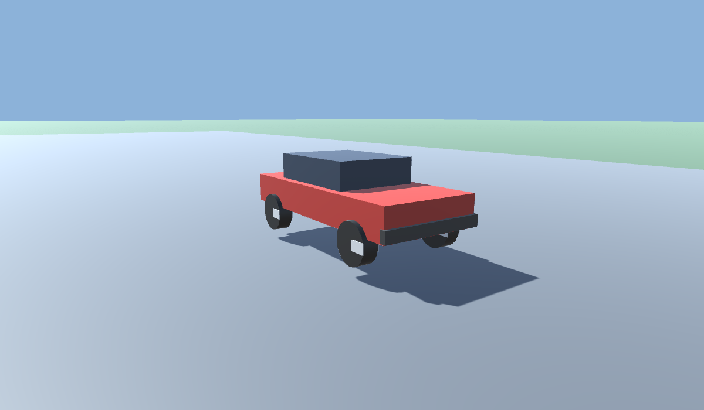

# Vehicle Physics

**Raycast-based car physics for Unity 6**: suspension that soaks up bumps and potholes, tire grip,
steering, handbrake drifts and a chase camera.

[English](#english) · [Türkçe](#türkçe)

<p align="center"></p>

---

<a name="english"></a>
# English

- Spring + damper suspension per wheel (separate bump/rebound damping, bump stops)
- Tire grip with a friction circle: the car slides when you ask too much of the tires
- Ackermann steering, speed-sensitive steering, anti-roll bars
- Rear-wheel, front-wheel or all-wheel drive
- Handbrake for drifting, reset button when you flip over
- Wheels visibly spin, steer and move up and down with the suspension
- Built-in test car and a procedural test track (bumps, speed bumps, potholes, ramp)
- Works with your own car model: a builder sets it up in one click

**Requirements:** Unity 6 (6000.0+), Input System package.

## Step-by-step setup

### 1. Add the package

1. **Window > Package Manager** → **+** → **Install package from git URL…**
2. Paste and click **Install**:

   ```
   https://github.com/Atthree/VehiclePhysics.git
   ```

If Unity asks *"Enable the new input backends?"*, click **Yes**.

### 2. Try the test scene

1. **File > New Scene** (any template).
2. **Tools > Vehicle Physics > Create Test Scene (Track + Car)**.
3. Press **Play**.

| Keyboard | Gamepad | Action |
|---|---|---|
| W / ↑ | Right trigger | Accelerate |
| S / ↓ | Left trigger | Brake; reverse once stopped |
| A D / ← → | Left stick | Steer |
| Space | B | Handbrake (drift) |
| R | Y | Reset the car upright |
| Hold right mouse + move | – | Look around (camera returns behind the car) |

The test track runs along +Z from the start:

| Distance | Section |
|---|---|
| 0 – 30 m | Flat start (and loose crates on the left) |
| 30 – 80 m | Rolling bumps |
| 80 – 110 m | Speed bumps every 6 m |
| 110 – 150 m | Rough road with potholes |
| 150 – 200 m | Flat, then a ramp |

The panel in the top-left shows speed and each wheel's suspension compression.

### 3. Use your own car model

1. Put the car in the scene. Its forward direction must be the blue arrow (+Z) and the wheels must
   touch the ground.
2. **Tools > Vehicle Physics > Builder (Your Own Model)**.
3. Drag the car root into **Araç Kökü** (Vehicle Root) and the four wheel meshes into the wheel
   fields. Wheels named like `FL`, `Wheel_FR`, `RearLeft` are found automatically.
4. Click **Build**, then **Play**.

The builder:

- Adds a Rigidbody and a `VehicleController` to the root.
- Adds a box collider around the body if the car has no collider.
- Creates a suspension point (`Wheel FL`, …) above each wheel. The height is calculated so that
  the wheels stay exactly where they are in the model when the car stands still.
- Reads the wheel radius from the wheel mesh.

## Tuning

Select the car to see everything in the Inspector. Values changed in Play mode are lost when you
stop.

| Wish | Component → Field |
|---|---|
| Faster / slower | `VehicleController` → **Max Speed** |
| Stronger acceleration | `VehicleController` → **Motor Force** |
| Shorter braking | `VehicleController` → **Brake Force** |
| Turns sharper | `VehicleController` → **Max Steer Angle** |
| Less nervous at high speed | `VehicleController` → **High Speed Steer Factor** (lower) |
| Leans less in corners | `VehicleController` → **Anti Roll Stiffness** (raise) |
| Flips over too easily | `VehicleController` → **Center Of Mass Offset** Y (lower), **Tire Force Height** (raise) |
| Longer / shorter drifts | `VehicleController` → **Handbrake Grip** |
| Softer / harder ride | Each `Wheel` → **Spring Stiffness** |
| Bounces too much after bumps | Each `Wheel` → **Rebound Damper** (raise) |
| Bumps kick the car too hard | Each `Wheel` → **Bump Damper** (lower) |
| More / less grip | Each `Wheel` → **Friction**, **Lateral Response** |
| Front, rear or all-wheel drive | Each `Wheel` → **Drive** |

## How it works

Each `VehicleWheel` object is the **top** of a suspension. Every physics step it casts a sphere the
size of the wheel straight down:

```
   ● anchor (Wheel FL)
   |
   |  distance (0 = fully compressed, Suspension Length = fully extended)
   |
  (●) wheel center
 ‾‾‾‾‾ ground
```

If the sphere hits the ground:

1. **Suspension:** `spring × compression + damper × compression speed` pushes the body up. The
   damper is softer while compressing than while extending. Above a "knee" speed its slope drops,
   so a sudden bump doesn't launch the car. A bump stop stiffens the last 15% of travel.
2. **Sideways grip:** a force that tries to cancel the wheel's sideways sliding speed.
3. **Drive / brake:** engine force on driven wheels; brakes never push the car backwards.
4. **Friction circle:** forces 2 and 3 together can't exceed `friction × load`. A wheel with little
   load (going over a crest) has little grip, like a real tire.

`VehicleController` runs the steps in order: pedals → steering (Ackermann) → all suspensions →
anti-roll bars → all tires → downforce.

| File | Job |
|---|---|
| `Runtime/VehicleWheel.cs` | Suspension and tire forces of one wheel, wheel visuals |
| `Runtime/VehicleController.cs` | Engine, brakes, steering, anti-roll bars, order of the steps |
| `Runtime/VehicleCommands.cs` | What the car is asked to do: throttle, steer, handbrake |
| `Runtime/PlayerVehicleInput.cs` | Input System → `VehicleCommands` |
| `Runtime/VehicleCamera.cs` | Chase camera |
| `Runtime/VehicleHud.cs` | Debug panel: speed and suspension |
| `Runtime/VehicleSetup.cs` | Turns any model into a car (used by the builder) |
| `Runtime/VehiclePrimitives.cs` | The test car |
| `Runtime/TestTrack.cs` | The procedural test track |
| `Editor/VehicleBuilderWindow.cs`, `Editor/VehicleMenus.cs` | Builder window and menus |
| `Tests/Runtime/VehicleTests.cs` | PlayMode tests |

Driving from code (AI, cutscenes), instead of `PlayerVehicleInput`:

```csharp
var car = GetComponent<VehicleController>();
car.commands.throttle = 1f;    // -1..1
car.commands.steer = -0.5f;    // -1 left .. 1 right
car.commands.handbrake = false;
```

## Tests

The package has 7 PlayMode tests: settling on the suspension, accelerating and braking, reversing,
cornering without rolling over, wheel spin and Ackermann steering, driving over the whole test
track, and handbrake drifting. To run them, add this to your project's `Packages/manifest.json`:

```json
"testables": [ "com.atthree.vehicle-physics" ]
```

then open **Window > General > Test Runner > PlayMode**.

## License

[MIT](LICENSE.md)

---

<a name="türkçe"></a>
# Türkçe

- Her tekerlekte yay + amortisör süspansiyon (sıkışma/açılma için ayrı sönüm, tampon)
- Sürtünme çemberli lastik tutuşu: lastiklerden fazlasını isteyince araç kayar
- Ackermann direksiyon, hıza duyarlı direksiyon, viraj demiri
- Arkadan itiş, önden çekiş ya da 4x4
- El freniyle drift, takla atınca düzeltme tuşu
- Tekerlekler görsel olarak döner, direksiyonla çevrilir, süspansiyonla iner-kalkar
- Hazır test arabası ve prosedürel test pisti (tümsekler, hız kesiciler, çukurlar, rampa)
- Kendi araba modelinle de çalışır: Builder tek tıkla kurar

**Gereksinimler:** Unity 6 (6000.0+), Input System paketi.

## Adım adım kurulum

### 1. Paketi ekle

1. **Window > Package Manager** → **+** → **Install package from git URL…**
2. Yapıştır ve **Install**'a bas:

   ```
   https://github.com/Atthree/VehiclePhysics.git
   ```

Unity *"Enable the new input backends?"* diye sorarsa **Yes** de.

### 2. Test sahnesini dene

1. **File > New Scene** (herhangi bir şablon).
2. **Tools > Vehicle Physics > Create Test Scene (Track + Car)**.
3. **Play**'e bas.

| Klavye | Gamepad | İş |
|---|---|---|
| W / ↑ | Sağ tetik | Gaz |
| S / ↓ | Sol tetik | Fren; durunca geri vites |
| A D / ← → | Sol stick | Direksiyon |
| Space | B | El freni (drift) |
| R | Y | Aracı düzelt |
| Sağ fare basılı + hareket | – | Etrafa bak (kamera sonra arkaya döner) |

Test pisti başlangıçtan +Z yönünde uzanır:

| Mesafe | Bölüm |
|---|---|
| 0 – 30 m | Düz kalkış (solda itilebilir kasalar) |
| 30 – 80 m | Dalgalı tümsekler |
| 80 – 110 m | Her 6 m'de bir hız kesici |
| 110 – 150 m | Çukurlu bozuk yol |
| 150 – 200 m | Düz, sonunda rampa |

Sol üstteki panel hızı ve her tekerleğin süspansiyon sıkışmasını gösterir.

### 3. Kendi araba modelini kullan

1. Arabayı sahneye koy. İleri yönü mavi ok (+Z) olmalı, tekerlekler yere değmeli.
2. **Tools > Vehicle Physics > Builder (Your Own Model)**.
3. Arabanın kökünü **Araç Kökü** alanına, dört tekerlek mesh'ini tekerlek alanlarına sürükle.
   `FL`, `Wheel_FR`, `RearLeft` gibi isimli tekerlekler otomatik bulunur.
4. **Build**, sonra **Play**.

Builder şunları yapar:

- Köke Rigidbody ve `VehicleController` ekler.
- Arabada collider yoksa gövdenin çevresine kutu collider ekler.
- Her tekerleğin üstüne bir süspansiyon noktası (`Wheel FL`, …) koyar. Yüksekliği, araç dururken
  tekerlekler modeldeki yerlerinde kalacak şekilde hesaplanır.
- Tekerlek yarıçapını mesh'ten okur.

## Ayarlar

Arabayı seçince her şey Inspector'da. Play modunda değiştirilen değerler Play'den çıkınca kaybolur.

| İstek | Bileşen → Alan |
|---|---|
| Daha hızlı / yavaş | `VehicleController` → **Max Speed** |
| Daha güçlü hızlanma | `VehicleController` → **Motor Force** |
| Daha kısa fren | `VehicleController` → **Brake Force** |
| Daha keskin dönüş | `VehicleController` → **Max Steer Angle** |
| Yüksek hızda daha sakin | `VehicleController` → **High Speed Steer Factor** (düşür) |
| Virajda daha az yatsın | `VehicleController` → **Anti Roll Stiffness** (artır) |
| Kolay devriliyor | `VehicleController` → **Center Of Mass Offset** Y (düşür), **Tire Force Height** (artır) |
| Daha uzun / kısa drift | `VehicleController` → **Handbrake Grip** |
| Daha yumuşak / sert sürüş | Her `Wheel` → **Spring Stiffness** |
| Tümsekten sonra fazla sekiyor | Her `Wheel` → **Rebound Damper** (artır) |
| Tümsekler aracı fazla sarsıyor | Her `Wheel` → **Bump Damper** (düşür) |
| Daha çok / az tutuş | Her `Wheel` → **Friction**, **Lateral Response** |
| Önden, arkadan ya da 4x4 | Her `Wheel` → **Drive** |

## Nasıl çalışıyor?

Her `VehicleWheel` objesi bir süspansiyonun **üst noktasıdır**. Her fizik adımında buradan aşağı,
tekerlek büyüklüğünde bir küre atılır (şema için [How it works](#how-it-works)).

Küre yere değiyorsa:

1. **Süspansiyon:** `yay × sıkışma + amortisör × sıkışma hızı` gövdeyi yukarı iter. Amortisör
   sıkışırken açılırken olduğundan yumuşaktır. Bir "diz" hızının üstünde eğimi azalır, böylece ani
   bir tümsek aracı fırlatmaz. Son %15'lik kısımda tampon sertleşir.
2. **Yanal tutuş:** tekerleğin yana kayma hızını sıfırlamaya çalışan kuvvet.
3. **İtiş / fren:** çeken tekerleklere motor kuvveti; fren aracı asla geriye itmez.
4. **Sürtünme çemberi:** 2 ve 3'ün toplamı `friction × yük`'ü geçemez. Az yük taşıyan tekerleğin
   (tepeyi aşarken) tutuşu az olur, gerçek lastik gibi.

`VehicleController` adımları sırayla çalıştırır: pedallar → direksiyon (Ackermann) → tüm
süspansiyonlar → viraj demirleri → tüm lastikler → yere basma kuvveti. Dosya listesi için
[How it works](#how-it-works) bölümüne bak.

Koddan sürmek için (yapay zeka, ara sahne), `PlayerVehicleInput` yerine:

```csharp
var car = GetComponent<VehicleController>();
car.commands.throttle = 1f;    // -1..1
car.commands.steer = -0.5f;    // -1 sol .. 1 sağ
car.commands.handbrake = false;
```

## Testler

Pakette 7 PlayMode testi var: süspansiyona oturma, hızlanma ve fren, geri vites, devrilmeden
viraj, tekerlek dönüşü ve Ackermann, tüm test pistini geçme, el freniyle drift. Çalıştırmak için
projenin `Packages/manifest.json` dosyasına ekle:

```json
"testables": [ "com.atthree.vehicle-physics" ]
```

sonra **Window > General > Test Runner > PlayMode**.

## Lisans

[MIT](LICENSE.md)
